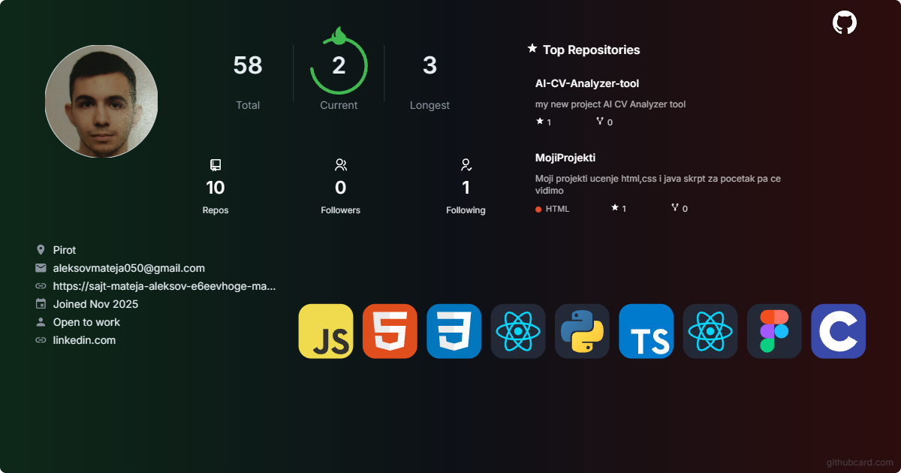

# Hi, I'm Mateja Aleksov 👋

A passionate frontend developer and data engineer from Serbia

- 🔭 I'm working on Wayfair n8n AI agent Engineering Externship
- 🌱 I'm learning Php
- 💬 Ask me about FrontEnd
- ⚡ Fun fact: Vibecoding is my passion.

## AI I use

     

## My GitHub

## Find me

[X](https://x.com/Mateja_SD) · [LinkedIn](https://www.linkedin.com/in/mateja-aleksov-03aa35272) · [Email](mailto:aleksovmateja050@gmail.com)

---

  

